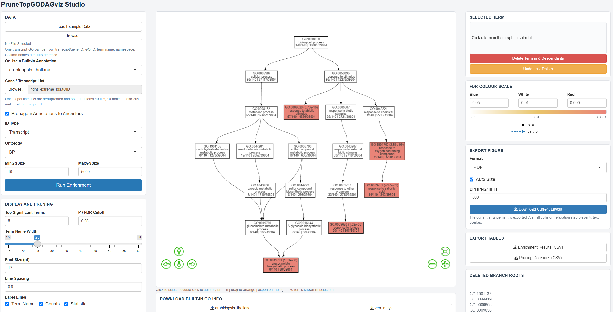

# PruneTopGODAGviz

Publication-quality Gene Ontology DAGs from over-representation results, with
display pruning that leaves the enrichment statistics unchanged.

`PruneTopGODAGviz` reads transcript- or gene-level GO annotation tables, runs a
self-contained hypergeometric over-representation test, and draws a GO DAG.
The graph can be pruned, rearranged, simplified and exported without changing
the enrichment result.



*Example PruneTopGODAGviz output.*

## Features

- Reads transcript- or gene-level GO annotation tables.
- Self-contained hypergeometric over-representation analysis.
- Supports BP, MF and CC ontologies.
- Deterministic DAG layout, branch pruning, chain collapsing and merging of
  similar terms.
- Shiny editor with node dragging, branch deletion, undo/reset and colour
  controls.
- PDF, PNG, SVG and TIFF export at 800 dpi, with exact page-size control.
- Interactive HTML output.
- Toggle the enrichment count line (`GeneRatio | BgRatio`) on screen and in exports.
- Compressed PANTHER annotation tables for six species and example data are
  included.
- Enrichment runs in a background worker, keeping the Shiny interface
  responsive.

## Requirements

- R >= 4.2
- `GO.db` and `AnnotationDbi` from Bioconductor (required)
- `shiny`, `visNetwork`, `colourpicker`, `future`, `promises`
- `ragg`, `svglite`, `ggiraph`, `htmlwidgets`, `htmltools`

## Installation

### 1. Install GO.db and AnnotationDbi

```r
if (!requireNamespace("BiocManager", quietly = TRUE)) {
  install.packages("BiocManager")
}

BiocManager::install(
  c("GO.db", "AnnotationDbi"),
  update = FALSE,
  ask = FALSE
)
```

### 2. Install the Shiny, background and export packages

```r
install.packages(
  c(
    "shiny", "visNetwork", "colourpicker",
    "future", "promises",
    "ragg", "svglite",
    "ggiraph", "htmlwidgets", "htmltools"
  ),
  dependencies = TRUE
)
```

| Package(s) | Used for |
|---|---|
| `shiny`, `visNetwork`, `colourpicker` | Interactive editor |
| `future`, `promises` | Background enrichment |
| `ragg` | PNG and TIFF export |
| `svglite` | SVG export |
| `ggiraph`, `htmlwidgets` | Interactive HTML |
| `htmltools` | Shiny/HTML support |

### 3. Install PruneTopGODAGviz

```r
install.packages(
  "https://github.com/RemagenRe/PruneTopGODAGviz/releases/download/v0.1.11/PruneTopGODAGviz_0.1.11.tar.gz",
  repos = NULL,
  type = "source",
  dependencies = TRUE
)
```

### 4. Verify

Restart R, then run:

```r
library(PruneTopGODAGviz)
packageVersion("PruneTopGODAGviz")
```

The expected version is `0.1.11`.

## Shiny editor

```r
library(PruneTopGODAGviz)
PruneTopGODAGviz::run_app()
```

In the editor:

1. Select a built-in species annotation or upload a GO annotation table.
2. Upload a gene or transcript ID list.
3. Choose the ID type and ontology.
4. Run enrichment.
5. Drag, delete or collapse terms.
6. Export the figure.

Deleting a term also removes descendants that become orphaned. A child that
still has another parent remains in the graph. Use **Undo Last Delete** to
restore the most recent deletion.

## GO OBO file

The full `go-basic.obo` is not bundled. It is downloaded and cached on first
use, or supplied as a local file. The lookup order is:

1. the `obo` argument;
2. `getOption("PruneTopGODAGviz.obo")`;
3. the package cache directory;
4. the online GO OBO file.

Use a local file with:

```r
PruneTopGODAGviz::run_app(obo = "D:/GO/go-basic.obo")
```

Or:

```r
options(PruneTopGODAGviz.obo = "D:/GO/go-basic.obo")
PruneTopGODAGviz::run_app()
```

Download the OBO file explicitly:

```r
PruneTopGODAGviz::download_go_obo(dest = "D:/GO/go-basic.obo")
```

If the OBO file is unavailable, `go_dag()` uses `GO.db`; this fallback labels
all relations as `is_a`. Use the OBO file when `part_of` relations are needed.
The bundled `mini.obo` is only for examples and tests.

## Built-in data

The package contains compressed PANTHER annotation tables for:

- Arabidopsis thaliana
- Zea mays
- Oryza sativa
- Glycine max
- Homo sapiens
- Mus musculus

It also includes a mini OBO, example annotation and 5,167 Arabidopsis example
genes. Source and licence information are in
[`inst/extdata/DATA_PROVENANCE.md`](inst/extdata/DATA_PROVENANCE.md).

## R usage

```r
library(PruneTopGODAGviz)

anno <- read_go_annotation(
  system.file(
    "extdata", "At_GO_info_panther.csv.gz",
    package = "PruneTopGODAGviz"
  ),
  keytype = "gene"
)

genes <- readLines("genes.txt")

ego <- enrich_go(genes, anno, ont = "BP")
dag <- go_dag("BP")

pruned <- prune_go_dag(
  ego,
  dag = dag,
  top_n = 10,
  p_cutoff = 0.05,
  collapse_chains = TRUE,
  cluster_jaccard = 0.85
)

p <- plot_go_dag(pruned)
save_go_dag(pruned, "BP_pruned", plot = p, dpi = 800)
```

Run BP, MF and CC together:

```r
run_go_workflow(
  genes,
  anno,
  outdir = "GO_figures",
  ont = c("BP", "MF", "CC")
)
```

Create an interactive HTML figure:

```r
plot_go_dag_interactive(pruned, file = "BP_pruned.html")
```

## Export

The export panel supports:

- **Match on-screen layout**: reuse the panel spacing and curved edges (default);
- **Auto Size** off: fill the requested Width/Height exactly;
- **Include colour legend in the figure**: optional colour legend;
- export filenames include seconds to avoid overwriting.

- PDF: vector output for journal submission
- PNG and TIFF: `ragg`
- SVG: `svglite`
- Default resolution: 800 dpi

Pruning changes the displayed DAG only. The enrichment statistics and the
pruned result table remain available. Exported tables include `pvalue`,
`p.adjust` and `qvalue`.

## Citation

Concept DOI:

```text
https://doi.org/10.5281/zenodo.23587324
```

Citation information is also available in R:

```r
citation("PruneTopGODAGviz")
```

Cite the Gene Ontology Consortium, PANTHER and the genome annotation resources
listed in [`inst/extdata/DATA_PROVENANCE.md`](inst/extdata/DATA_PROVENANCE.md).

## License

Package code: MIT. Built-in annotation tables retain their upstream terms; see
[`inst/extdata/DATA_PROVENANCE.md`](inst/extdata/DATA_PROVENANCE.md).

## Links

- Repository: <https://github.com/RemagenRe/PruneTopGODAGviz>
- Latest release: <https://github.com/RemagenRe/PruneTopGODAGviz/releases/tag/v0.1.11>
- Issues: <https://github.com/RemagenRe/PruneTopGODAGviz/issues>
- Chinese README: [README_zh.md](README_zh.md)
