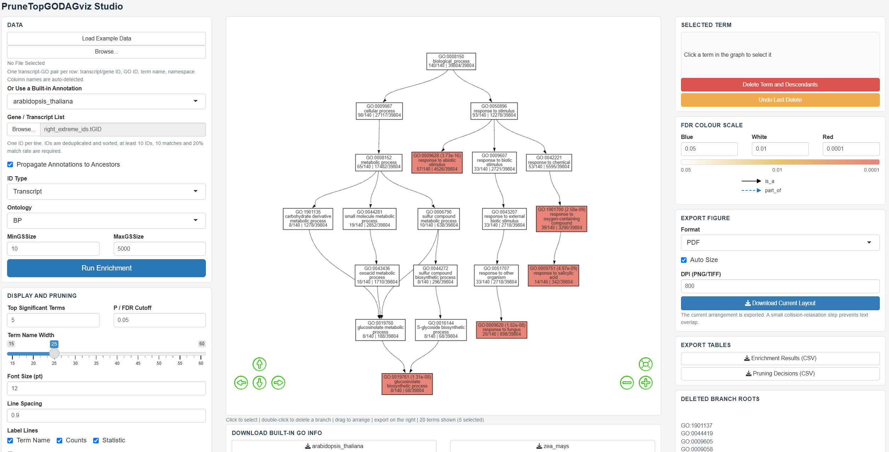

# PruneTopGODAGviz 中文说明

从 GO 富集结果生成适合发表的 Gene Ontology DAG，并且只改变图形的展示方式，
不改变富集统计结果。

`PruneTopGODAGviz` 读取 transcript 或 gene 级别的 GO 注释表，使用包内的超几何
检验完成 GO over-representation analysis，再绘制 GO DAG。图形可以剪枝、重排、
折叠和导出，富集结果保持不变。



*PruneTopGODAGviz 示例输出。*

## 主要功能

- 读取 transcript 或 gene 级别的 GO 注释表；
- 包内自包含的超几何富集检验；
- 支持 BP、MF、CC 三个本体；
- GO DAG 布局、剪枝、单子节点链折叠和相似 term 合并；
- Shiny 编辑器：拖动节点、删除分支、撤销、重置、调整颜色；
- 导出 PDF、PNG、SVG 和 TIFF，默认 800 dpi，可精确控制页面尺寸；
- 生成交互式 HTML 图；
- 可切换是否显示 `GeneRatio | BgRatio` 富集数值，屏幕和导出图同步生效；
- 可导入 PANTHER JSON 或通用 CSV/TSV 富集结果，再剪枝和导出（文件上限 50 MB）；
- 一键按图内现有 term 的 FDR 自动设置颜色条的三个分界值，设置后仍可手动修改。
- 内置六个物种的 PANTHER 注释表和示例数据；
- 富集在后台运行，并显示已运行时间；长时间计算时界面仍可响应。

## 环境要求

- R >= 4.2；
- Bioconductor 包：`GO.db`、`AnnotationDbi`（必须）；
- Shiny 和后台计算：`shiny`、`visNetwork`、`colourpicker`、
  `future`、`promises`；
- 导出和交互图：`ragg`、`svglite`、`ggiraph`、`htmlwidgets`、
  `htmltools`。

## 安装

### 第一步：安装 GO.db 和 AnnotationDbi

```r
if (!requireNamespace("BiocManager", quietly = TRUE)) {
  install.packages("BiocManager")
}

BiocManager::install(
  c("GO.db", "AnnotationDbi"),
  update = FALSE,
  ask = FALSE
)
```

### 第二步：安装 Shiny、后台计算和导出相关包

```r
install.packages(
  c(
    "shiny", "visNetwork", "colourpicker",
    "future", "promises",
    "ragg", "svglite",
    "ggiraph", "htmlwidgets", "htmltools"
  ),
  dependencies = TRUE
)
```

| 包 | 用途 |
|---|---|
| `shiny`、`visNetwork`、`colourpicker` | 交互式编辑器 |
| `future`、`promises` | 后台富集计算 |
| `ragg` | PNG、TIFF 导出 |
| `svglite` | SVG 导出 |
| `ggiraph`、`htmlwidgets` | 交互式 HTML |
| `htmltools` | Shiny/HTML 支持 |

### 第三步：安装 PruneTopGODAGviz

```r
install.packages(
  "https://github.com/RemagenRe/PruneTopGODAGviz/releases/download/v0.1.13/PruneTopGODAGviz_0.1.13.tar.gz",
  repos = NULL,
  type = "source",
  dependencies = TRUE
)
```

### 第四步：检查安装

重启 R，然后运行：

```r
library(PruneTopGODAGviz)
packageVersion("PruneTopGODAGviz")
```

应显示 `0.1.13`。

## Shiny 编辑器

```r
library(PruneTopGODAGviz)
PruneTopGODAGviz::run_app()
```

操作顺序：

1. 选择内置物种注释，或上传 GO 注释表；
2. 上传 gene/transcript ID 列表；
3. 选择 ID 类型和本体；
4. 运行富集；
5. 拖动、删除或折叠 term；
6. 导出图片。

删除 term 时会同时删除因此失去父节点的下游 term；如果某个子节点仍有其他父节点，
它会保留在图中。可以使用 **Undo Last Delete** 恢复最近一次删除。

## 导入外部富集结果

编辑器可以导入 PANTHER over-representation JSON，也可以导入包含 ID、p 值/FDR
和可选计数列的通用 CSV/TSV。外部结果不重新做统计：来源给的是校正值，就原样放在
`p.adjust` 与 `qvalue`；来源只有原始 p 值，`p.adjust` 与 `qvalue` 保持 `NA`，
编辑器的选择和配色改用原始 p 值并给出提示，绝不把原始 p 值写进 `p.adjust`。
只有 `GeneRatio` / `BgRatio` 时，计数取分子（`12/100` 得 `Count = 12`）；
格式不合法的比值会给出警告并置为缺失，不做猜测。图中的计数行只显示原始
`Count | BgCount`。导入后可以沿用现有的剪枝、编辑和导出流程。上传文件上限为
50 MB，超过的文件在解析前直接拒绝。

## 统计口径

- 内部 ORA 用超几何检验。BH 校正只作用于通过基因集大小过滤且至少有一个输入命中的
  term（`params$test_scope = "hit_terms"`）；零命中的 term 不参与检验，也不进入校正。
- 内部结果的 `qvalue` 是固定 `lambda = 0.5` 的 Storey 风格估计；导入结果的
  `qvalue` 是来源校正值的别名（`params$qvalue_is_alias = TRUE`），不代表重新跑了
  qvalue 算法。
- `counts = "propagated"` 按 true-path 规则统计，可能不同于检验时用的计数；
  要显示与检验完全一致的计数请用 `counts = "direct"`。界面在关闭
  **Propagate Annotations to Ancestors** 时会自动使用 direct。
- 内置 PANTHER 注释是基因级的，会扩展到该基因的每条转录本：转录本层面的结果
  携带的仍是基因级 GO 证据，见 `inst/extdata/DATA_PROVENANCE.md`。
- `cluster_jaccard` 不会合并 selected term；`max_nodes` 是目标上限，受保护的 term
  会被保留，达不到上限时给出警告。
- 每个剪枝结果都带 `provenance`（`package_version`、`r_version`、`source`、`stat`、
  `counts`、`generated_at`），可用 `jsonlite::write_json(x$provenance, "run.json")`
  与图片一起保存。

## GO OBO 文件

完整的 `go-basic.obo` 会在首次使用时下载并缓存。查找顺序：

1. `obo` 参数；
2. `getOption("PruneTopGODAGviz.obo")`；
3. 包缓存目录；
4. 在线 GO OBO 文件。

使用本地文件：

```r
PruneTopGODAGviz::run_app(obo = "D:/GO/go-basic.obo")
```

或：

```r
options(PruneTopGODAGviz.obo = "D:/GO/go-basic.obo")
PruneTopGODAGviz::run_app()
```

手动下载：

```r
PruneTopGODAGviz::download_go_obo(dest = "D:/GO/go-basic.obo")
```

OBO 不可用时，`go_dag()` 使用 `GO.db`，并将所有关系标记为 `is_a`。需要
`part_of` 关系时使用 OBO 文件。

完整的 `go-basic.obo` 不随包提供；包内的 `mini.obo` 仅用于示例和测试。

## 内置数据

包内包含以下物种的压缩 PANTHER 注释表：

- Arabidopsis thaliana（拟南芥）
- Zea mays（玉米）
- Oryza sativa（水稻）
- Glycine max（大豆）
- Homo sapiens（人）
- Mus musculus（小鼠）

还包含 mini OBO、示例 annotation 和 5,167 个拟南芥示例基因。数据来源和许可
见 [`inst/extdata/DATA_PROVENANCE.md`](inst/extdata/DATA_PROVENANCE.md)。

## 编程方式

```r
library(PruneTopGODAGviz)

anno <- read_go_annotation(
  system.file(
    "extdata", "At_GO_info_panther.csv.gz",
    package = "PruneTopGODAGviz"
  ),
  keytype = "gene"
)

genes <- readLines("genes.txt")

ego <- enrich_go(genes, anno, ont = "BP")
dag <- go_dag("BP")

pruned <- prune_go_dag(
  ego,
  dag = dag,
  top_n = 10,
  p_cutoff = 0.05,
  collapse_chains = TRUE,
  cluster_jaccard = 0.85
)

p <- plot_go_dag(pruned)
save_go_dag(pruned, "BP_pruned", plot = p, dpi = 800)
```

同时运行 BP、MF 和 CC：

```r
run_go_workflow(
  genes,
  anno,
  outdir = "GO_figures",
  ont = c("BP", "MF", "CC")
)
```

生成交互式 HTML：

```r
plot_go_dag_interactive(pruned, file = "BP_pruned.html")
```

## 导出

导出面板支持：

- **Match on-screen layout**：沿用网页的间距和曲线连线（默认开启）；
- 关闭 **Auto Size** 后，按指定的 Width/Height 精确填满页面；
- **Include colour legend in the figure**：可选是否在图中保留颜色图例；
- 导出文件名精确到秒，避免同一分钟内覆盖。

- PDF：矢量图，用于期刊投稿；
- PNG、TIFF：使用 `ragg`；
- SVG：使用 `svglite`；
- 默认分辨率：800 dpi。

剪枝只改变显示的 DAG，富集统计值和结果表保持不变。导出的表格包含
`pvalue`、`p.adjust` 和 `qvalue`。

## 引用

Concept DOI：

```text
https://doi.org/10.5281/zenodo.23587324
```

在 R 中查看引用信息：

```r
citation("PruneTopGODAGviz")
```

同时引用 Gene Ontology Consortium、PANTHER 以及
[`inst/extdata/DATA_PROVENANCE.md`](inst/extdata/DATA_PROVENANCE.md) 中列出的
基因组注释资源。

## 许可

包代码使用 MIT 许可。内置注释表保留上游来源的许可条款，见
[`inst/extdata/DATA_PROVENANCE.md`](inst/extdata/DATA_PROVENANCE.md)。

## 链接

- GitHub 仓库：<https://github.com/RemagenRe/PruneTopGODAGviz>
- 最新 Release：<https://github.com/RemagenRe/PruneTopGODAGviz/releases/tag/v0.1.13>
- 问题反馈：<https://github.com/RemagenRe/PruneTopGODAGviz/issues>
- English README：[README.md](README.md)
